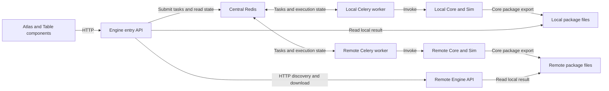

# DTCC Engine backend design

Date: 2026-09-06

Status: Agreed and implemented through increment 5 of the
[implementation plan](PLAN.md), which records progress and what remains.

## Purpose and authority

DTCC Engine exposes the Dataset capabilities of DTCC Core and DTCC Sim to
other DTCC Platform components. Atlas and Table are the initial consumers,
including the backend components supporting those experiences. Engine is a
Python integration service, not an application that end users operate directly.

This specification refines [DTCC Twin's design](../../docs/DESIGN.md) and follows
the [repository instructions](../../AGENTS.md) and
[Engine instructions](AGENTS.md). Core remains the authority
for Dataset definitions, DTCC Model semantics, input/output, validation, and
package contracts. Sim owns its simulation methods and specialized numerical
dependencies.

The first release provides discovery, asynchronous execution, job polling,
limited cancellation, and Dataset Package delivery. It delegates task execution
to Celery and uses one central Redis service for the broker and result backend.
It must not grow into a custom task queue, workflow engine, or cluster manager.

Engine evolves from Sim's existing mini-service and ultimately replaces it.
The intended end state is one maintained service implementation in Engine,
exposing both Core and Sim Dataset capabilities.

## Scope

### Included

- Generic discovery and invocation of all Core and Sim Dataset Definitions,
  including their supported semantic products and parameters within the input
  boundary below. There is no manually curated list of supported Dataset names.
- Requests containing Dataset parameters and geographic bounds.
- Asynchronous execution identified by a job ID, with status obtained by polling.
- Local execution and optional execution on configured remote compute hosts.
- Automatic placement with a local preference, and an explicit target per request.
- Concurrent jobs, limited by a configured job count on each compute host.
- One consumer-facing Engine HTTP address for submission, status, cancellation,
  and package downloads.
- A single shared configurable token for Engine HTTP authentication.
- Results delivered as `.dtccpkg` packages and retained for a configured
  period, 30 days by default, after completion, subject to the absence of
  recovery guarantees described below.
- Container deployments of the Engine production image on Linux hosts,
  self-hosted or on AWS EC2.

Each submitted job invokes one Dataset Definition. Dependencies and processing
steps internal to that Dataset remain in Core or Sim. Engine does not introduce
an application-level pipeline language or independently schedule the internal
stages of a Dataset.

All Datasets are in the integration scope, but availability is specific to an
execution environment. Missing dependencies, credentials, coverage, or canonical
exchange support must be reported where known. A missing upstream capability
does not justify a replacement implementation in Engine or a claim that full
Dataset coverage has been verified.

### Downstream responsibilities

Engine hands completed packages to downstream consumers. Those components own
durable storage, Package Catalogs, publication, access policies for saved data,
Twin Workspaces, Published Twins, and Table Catalog Releases. Engine's temporary
result storage is not a Package Catalog, and downloading or retaining a result
does not publish it.

Table's ordinary visitor experience continues to consume prepared, curated,
published content as specified by Twin's design. This backend does not change
Table into a live generation or simulation client. The initial shared API token
does not enforce different permissions for Atlas and Table.

### Deferred or excluded from v1

- Guaranteed persistence, restart recovery, job resumption, and high availability.
- Uploaded `.dtccpkg` inputs and other user-data upload or import workflows.
- Individual export-file download endpoints; delivery uses `.dtccpkg` only.
- Per-consumer tokens, roles, permissions, and quotas.
- Streaming status, server-sent events, callbacks, and completion webhooks.
- Automatic job retries, failover resubmission, and movement of accepted jobs
  between hosts.
- Guaranteed cancellation of running computations or custom solver interruption.
- CPU- or memory-aware scheduling, distributed capacity reservations, autoscaling,
  dynamic host registration, host provisioning, and SSH execution.
- Compatibility with arbitrary remote service APIs or legacy application layouts.
- Engine-owned serialization, simulation, publication, or domain data models.
- Native (non-container) installations and macOS hosts as deployment targets,
  and multi-host MPI execution of a single job.

## Runtime architecture

One deployment contains:

1. A consumer-facing Engine HTTP service.
2. One central Redis service, configured as Celery's broker and result backend.
3. A Celery worker on each configured compute host, including the local host.
4. The same Engine HTTP service on remote hosts for host-local discovery and
   package retrieval.
5. A temporary package directory on each executing host.

Every compute host runs the same Engine production image, which contains the
Engine software and the Core/Sim capabilities. The HTTP service and Celery
worker are separate containers from that image. Remote hosts do not require their own
Redis instance. A local-only deployment uses the same architecture with an
empty remote-host list.

Workers execute Core/Sim Python APIs in their own environment. Celery owns the
queue, worker processes, task results, and worker concurrency. Engine owns
the small amount of application coordination needed to select a configured
target, expose upstream contracts, arbitrate starting against cancellation,
record terminal job outcomes, translate job status, and deliver packages.

There is one job and one Celery task per Dataset invocation. Remote execution
does not create a central task that waits for another task over HTTP. The
selected worker executes the Dataset directly and does not forward it again.

Task dispatch uses the shared broker. Consumer requests, host-local discovery,
and package transfers use HTTP.

## Service evolution and replacement

Sim's existing mini-service is the starting point for Engine's service layer.
Reuse and adapt its applicable Dataset task integration, progress reporting,
HTTP behavior, and tests. Move service responsibilities into Engine while
keeping Dataset definitions, model semantics, and computation in Core and Sim.
Packaging improvements remain Core-owned upstream work.

The migration must identify existing service consumers and deployment entry
points, specify their transition to Engine, and verify the required replacement
behavior. Temporary coexistence is permitted during that transition. The final
architecture must not retain independently maintained Sim and Engine services
for the same responsibilities.

Once Engine satisfies the agreed acceptance checks and existing consumers have
transitioned, retire the original mini-service implementation and its deployment
entry points from Sim through a separate upstream change. That retirement is
part of completing the migration; it does not remove Sim's Dataset definitions
or numerical capabilities. Reference checkouts remain unchanged during Engine
work.

Core's `RemoteDatasetDescriptor` is a Python client, not the mini-service being
replaced. Engine workers invoke local Dataset APIs directly and do not use that
client for internal task dispatch. Adapting existing Python clients to Engine's
API, or changing the remote Dataset client's lifecycle, requires a separate
Core compatibility decision, requested in
[dtcc-core#161](https://github.com/dtcc-platform/dtcc-core/issues/161).
Replacing the Sim mini-service does not itself authorize removing the Core
client.

## Discovery and compatibility

Dataset descriptors and argument schemas come from Core's public registry and
Dataset interface. Importing Sim contributes its Dataset Definitions through
that same registry. Engine exposes those definitions with application metadata
about configured targets and observed availability. This is a discovery view,
not a competing Dataset registry.

Engine returns each registered Dataset's Core `describe()` output unchanged,
keyed by Dataset name. It does not filter Datasets by package, infer formats
from schemas, or supply default values for missing descriptor fields. The
listing also reports the installed Engine, Core, and Sim versions and a catalog
revision: a SHA-256 digest of the versions and descriptions, which changes
whenever either changes. Engine reads the registry on each request, so the
revision is the catalog's refresh mechanism; newly installed Python code still
requires restarting the Engine processes.

Each target reports its own local capabilities and installed Engine, Core, and
Sim versions. Host-local discovery must not recursively query other hosts.
The consumer-facing service combines this information for discovery and target
selection. A remote-only capability can be discovered without executing it on
the entry host. Because every host in a deployment runs the same image, a
capability is remote-only because of that host's runtime conditions, such as
credentials, data, hardware, or provider access, not because different code is
installed there.

The entry's Dataset listing reports each Dataset's targets: every configured
target, in placement order, with its state and reason as the entry observes
them for that request, and the Dataset's runtime availability on it, which is
unknown until Core can report it. The listing reads no other host's discovery:
a compatible target runs the entry's image and so offers its Datasets, and an
incompatible one is reported as such. An observation waits only seconds for a
broker that does not answer, so the listing still answers then, with each
target unknown. The catalog revision covers the versions and descriptions, not
the targets' states. Describing one Dataset returns its Core description
alone, and host-local discovery reports only its own catalog.

The catalog must have an explicit refresh operation or revision mechanism. A
new conforming Dataset using existing contracts becomes visible after it is
installed and registered on a target and the catalog is refreshed, without
Dataset-specific changes to Engine. In a deployment, new Python code arrives in
a new image rolled out to every host, which requires restarting the containers;
discovery is not a promise of arbitrary live code loading.

A target is compatible only when its Dataset contract and execution environment
match the request and the deployment's tested compatibility baseline. Record
the versions used to execute each job and preserve upstream provenance in the
resulting package. Reject incompatible targets rather than silently changing
parameters, semantic products, or model meaning.

When a worker claims a job, Engine records that worker's Engine, Core, and Sim
versions, and its image digest if the deployment supplies one, with the job,
and the job's status reports them as its environment. A job that no worker has
claimed has no environment, and a later delivery of a claimed job does not
change it. Core's provenance in the package stays as Core records it.

The job's record also keeps the image digest of the entry that accepted it, if
the deployment supplies one: the image whose Core validated the job's
parameters. A worker with another digest, or none, that claims the job fails it
with `IncompatibleWorker` instead of running it, and the job's status reports
that worker's environment. A job queued before its target's image changes
therefore does not run in the new environment. Without the entry's digest, as
in development, nothing is compared: the job runs in the environment of the
worker that claims it, and Core validates its parameters again when that worker
invokes the Dataset.

Compatibility and canonical exchange readiness must be verified from source,
tests, and representative execution. A descriptor alone is not proof that a
solver is installed, a provider is reachable, or a returned type satisfies
Core's lossless Protobuf contract.

## Routing and concurrency

Remote hosts are configured explicitly with stable target identifiers and their
Engine HTTP addresses. They do not register dynamically. Use a Celery queue for
each configured compute target. Each host's worker consumes only its designated
queue, refusing to start with any other, and enforces the configured
concurrent-job count.

Requests select automatic placement, local execution, or a named remote target.

| Request or condition                                                                | Required behavior                                                                                                                                  |
| ----------------------------------------------------------------------------------- | -------------------------------------------------------------------------------------------------------------------------------------------------- |
| Automatic placement; local host is available, compatible, and has observed capacity | Submit to the local queue.                                                                                                                         |
| Automatic placement; local host is unavailable, lacks capacity, or is incompatible  | Select an available compatible remote host with observed capacity, in configuration order.                                                         |
| All reachable compatible hosts are busy                                             | Queue locally if the local host is compatible and available; otherwise queue on the first available compatible remote host in configuration order. |
| Explicit local or remote target is busy                                             | Queue on that target.                                                                                                                              |
| Explicit target is unavailable, unknown, or incompatible                            | Reject the request with an explanation; do not substitute another target.                                                                          |
| No compatible available target exists                                               | Reject the request with an explanation.                                                                                                            |

Availability means that a target can accept queued work; capacity means that it
appears to have room to start another job. A busy target can still be available.
HTTP liveness alone must not be treated as proof that its Celery worker is ready.

Engine observes a target through the broker. The target's worker answers with
its image digest, versions, job limit, the jobs it holds, and the queues it
consumes, never with a job's arguments, and the broker counts the jobs waiting
in the target's queue. A target is available when its worker answers and
consumes exactly its target's queue, and has capacity when the worker holds
fewer jobs than its limit and none wait. A target whose worker does not answer
is unknown: Engine does not conclude that the worker stopped, and routing
treats the target as unavailable.

A request names a configured target or none. Engine validates the request
before it observes any target, and rejects an identifier that is not configured
as invalid. Without a named target, Engine observes the local target, then the
remote targets in configuration order, and places the job on the first one with
capacity, observing no further; if none has capacity, on the first one that is
available and compatible. A named target is observed alone, and takes the job
if it is available and compatible, with capacity or without. Engine observes
each target once per request, so a late answer leaves it unknown. A request
that no observed target can accept is rejected as temporarily unavailable, with
each observed target's state and reason, and is neither recorded nor queued.
The job's record names the selected target, and its message goes to that
target's queue. Engine validates a request with its own Dataset registry, which
is the selected target's, because compatible targets run the same image
(Deployment and authentication).

Reported load is a placement hint. Concurrent submissions can observe the same
capacity, so automatic placement does not guarantee immediate execution. Celery
enforces the actual job-count limit. Engine must not add a distributed slot
reservation protocol to make the placement hint exact.

After submission, a job remains assigned to its selected host. There is no
rebalancing, work stealing, or automatic rerouting when that host becomes busy
or unavailable. There are no CPU or memory resource estimates in v1 scheduling.

## Consumer API contract

Engine provides the following operations through its versioned HTTP API, under
`/api/v1`.

| Operation                 | Input                                                                                           | Output                                                                                                              |
| ------------------------- | ----------------------------------------------------------------------------------------------- | ------------------------------------------------------------------------------------------------------------------- |
| List or describe Datasets | Optional Dataset identity                                                                       | Upstream descriptors, parameter schemas, supported semantic products, and target availability.                      |
| List compute targets      | No Dataset request required                                                                     | Configured target identifiers, versions, local capabilities, and observed availability.                             |
| Submit a job              | Dataset name, parameter object including bounds where applicable, and optional execution target | Accepted job ID and a status reference; no wait for Dataset completion.                                             |
| Get job status            | Job ID                                                                                          | Execution state, available progress, useful error information, confirmed cancellation, and result availability.     |
| Download a result         | Completed job ID                                                                                | The validated `.dtccpkg` archive.                                                                                   |
| Request cancellation      | Job ID                                                                                          | Confirmed pre-execution cancellation, an already finished job, or refusal because execution permission was claimed. |

Consumer requests are JSON-compatible descriptions of Dataset invocations. They
do not carry Python model objects, uploaded data, arbitrary code, or arbitrary
execution-host URLs. An explicit execution target must resolve to a configured
identifier.

Core's existing Dataset contract validates Dataset arguments before execution;
Engine validates only its own request envelope and target selection. The
selected target's authoritative contract must be used for validation. Engine
must not maintain hand-written copies of Dataset argument models.

Bounds, units, coordinate reference systems, dimensionality, and parameter
defaults follow the selected Core/Sim Dataset contract. Engine must not
reinterpret numeric bounds as another coordinate system or silently fill
scientific choices using application-specific assumptions.

Semantic product selection remains a Dataset parameter. The delivery container
is `.dtccpkg`; it must not be confused with a Dataset's legacy `format=` path
that returns serialized bytes. Any choice of supplementary package artifacts
must use Core's export contract and must not trigger a second Dataset
computation merely to serialize an existing realization.

Job status distinguishes queued, running, completed, failed, and confirmed
cancelled work. A job whose submission the broker did not confirm is
unconfirmed rather than queued, because it may or may not be queued; it is
reported as running once a worker starts it, and Engine never sends it again.
Cancellation is confirmed only by Engine's recorded outcome. A cancel response
with `result=cancelled` confirms it; a communication failure or lost response
leaves the caller uncertain until polling resolves the outcome. Unknown or expired
jobs and temporary status unavailability must be distinguishable from queued
work.

A status reference, `status_url`, is the path of the job's status route from
the server's root. Behind a reverse proxy that serves Engine under a path prefix
it includes that prefix, the API's ASGI root path.

An explicit Engine outcome of `completed`, `failed`, or `cancelled` is
authoritative over Celery metadata. A finish timestamp alone does not establish
an outcome. Celery still supplies observed task state and progress when no
Engine outcome is recorded; a failure without Engine finish metadata must not
be silently turned into running work or assigned an invented finish time.
Celery `SUCCESS` alone does not authorize a package download, and `REVOKED`
alone does not confirm cancellation. Missing or inconsistent information must
be reported as unavailable where an outcome cannot be established.

Progress reports upstream measurements and messages when available. A running
job without measured progress must not be given an invented percentage or
completion estimate. Consumers obtain updates by polling; streaming is outside
the first release.

## Package creation, delivery, and retention

The worker invokes the Dataset to obtain its native DTCC Model realization with
Dataset Context. It uses Core's object/package export capabilities to create
the `.dtccpkg` archive. It must not duplicate serializers, manifests, package
validation, or Protobuf handling in Engine.

For semantic DTCC data, every delivered package must include:

- An authoritative manifest containing Dataset identity, the exact request,
  provenance, health, warnings, and artifact information.
- A canonical DTCC Protobuf model artifact satisfying Core's versioned,
  lossless model-exchange contract.
- Any additional artifacts provided through Core's package contract, with their
  roles and relationships described by the manifest.

Intrinsic model facts belong in the canonical model. Dataset request and
provenance context belong in the manifest. Consumers use the manifest to select
artifacts rather than infer meaning from filenames. A derived image or mesh
export cannot replace the canonical model artifact.

Before offering a download, use Core's validated package boundary to check the
required content, schema compatibility, model type, and artifact integrity.
Packages under construction must not be exposed as completed results. Required
packaging or integrity failures fail result delivery clearly. A valid
realization remains valid if an optional presentation artifact fails; Core's
contract must determine whether a complete package can be emitted with the
appropriate warning.

The executing host stores the completed package. Redis stores job state and
references to the package and host, not archive contents or in-memory model
objects. The public Engine address serves local files or streams the remote
archive through the remote host's Engine HTTP API. No shared filesystem between
hosts is required, and forwarding a download does not require a second stored
copy at the entry host.

Each host serves its own packages through a host-local route, which never
forwards a request to another host. A completed job's status says whether its
package can be downloaded; for a job of a remote target, the entry asks that
target's host, and reports `null` when it cannot tell, for example because the
host does not answer, rejects the token, or the target is not configured. A
download through the entry streams the package from the job's host without
asking for the job's status first, stores nothing at the entry, follows no
redirects, and sends the shared token only to the configured address. A host
without the package makes the download a `409`, as a local one is; a host that
cannot be reached, rejects the token, or answers otherwise, and a target that is
not configured, make it a `503`, without the host's answer. The entry closes its
request to the host when the download ends, whether it completed, failed, or the
consumer disconnected, and a stream that fails midway fails the download rather
than end it as a shorter archive.

Completed packages expire the retention after job completion: the deployment's
`ENGINE_RETENTION_DAYS`, 30 by default, measured as periods of 24 hours using
UTC timestamps. Downloads do not extend that period. Under normal operation,
job-result metadata must remain available throughout the package retention
window. Each host must automatically clean up expired package
files; broker metadata expiry alone is insufficient. Host outages can delay physical cleanup,
but expired packages must not become newly available merely because their files
remain on disk.

Every API and worker that shares a Redis uses the same retention: each API
computes a job's expiry, and each worker deletes packages, by its own setting,
so hosts with different settings would disagree on whether a job is available.
A job's records last a day longer than the retention, from the change of state
that last set their lifetime. A changed setting applies to later changes of
state and to every later expiry check, not to records already written: a
finished job keeps the record lifetime set when it finished, so raising the
retention does not keep it longer, and lowering it expires older jobs at once
and deletes their packages at the next cleanup.

Each host's worker deletes the packages that no job can deliver when it starts
and every hour: those whose job is unknown or expired, failed, was cancelled, or
completed more than the retention ago. A package stays while its job has no
outcome or its record is unusable. Deleting a package is retention; it does not
show that the job's computation stopped. When the worker starts, before it runs
any job, it also deletes the staging directories that exports left beside the
packages: the host's worker is the only one that exports there, and it starts
only after its earlier run stopped (Restart behavior), so those exports were
killed. A staging directory left while the worker runs stays until the worker
starts again.

The retention is a temporary policy, not a persistence guarantee.
Downstream consumers must store results they need to retain durably.

## Failures, cancellation, and restarts

### Failure reporting

- Invalid requests fail before submission, with the selected Dataset's useful
  validation details.
- Dataset failures and required package-creation failures produce failed jobs.
  Incomplete packages are not downloadable.
- Failed jobs require explicit consumer resubmission. Engine adds no automatic
  execution retries or failover resubmission.
- Broker or host communication failure means the latest state may be
  unavailable. It must not be reported as proof that the computation failed or
  stopped. If submission acknowledgement is lost, acceptance can be uncertain;
  Engine must not silently submit the job again.
- An unknown or expired job ID is identified explicitly. Celery's `PENDING`
  value alone cannot establish that a job was accepted and is queued, as
  documented in its [task states](https://docs.celeryq.dev/en/stable/userguide/tasks.html#pending).
- Returning an error must not expose the API token, provider credentials, or
  unrestricted internal tracebacks. Operational diagnostics can retain the
  information needed to investigate the job.

The start gate below allows at most one delivery to claim execution for a
surviving acceptance record. This is not an exactly-once execution or
duplicate-submission guarantee: a crash after the claim can leave the Dataset
uninvoked, and separate submissions have separate job IDs. It supplies no
durability or recovery guarantee after Redis state loss or rollback. Broker
reconnection and read-only status polling do not constitute permission for
Engine to retry a Dataset computation.

### Cancellation

V1 supports cancellation before a worker claims permission to invoke the
Dataset. Engine records `execution_gate=waiting` with the acceptance fields
before publishing the job. Engine validates the existing record, then a Redis
Lua operation checks its gate and terminal fields and atomically makes one of two
decisions. The acceptance fields never change once written, so validating them
before the operation keeps each decision atomic:

- The worker changes `waiting` to `started` immediately before Dataset
  invocation. Only the delivery that wins this transition may compute.
- Cancellation changes `waiting` to `cancelled` and records
  `outcome=cancelled`, the UTC `finished_at`, and a record TTL of the retention
  plus a day together.

Neither transition creates a record or overwrites a previous decision. Missing
acceptance fields, a missing or unknown gate, and inconsistent outcome metadata
cannot grant execution permission. A message whose record is absent never
computes, including delivery after record expiry. There is no legacy execution
path for gate-less records after the one-time development transition below.

Cancelled or duplicate deliveries, and deliveries without usable acceptance
records, bypass Dataset invocation and ordinary finalization. They use Celery
`Ignore`, so they do not write `SUCCESS` or change Engine outcomes, timestamps,
errors, or packages. Celery may write `STARTED` before the task body runs;
Engine's recorded terminal outcome must still win when status is read.

The winning execution records `outcome=completed` only after Core's package
validation succeeds, or `outcome=failed` with the original exception type on
failure. One conditional Lua operation checks that the record still exists with
its `started` gate and no outcome, relying on the acceptance validation made when
execution was claimed, then writes the outcome, UTC finish time, applicable
exception metadata, and a TTL of the retention plus a day together. It never
creates a missing record or overwrites an existing outcome. No separate worker exception write may
recreate a record. Lost records and packages left without usable records remain
lifecycle concerns; they do not justify fabricating terminal metadata.

If a start operation fails or its response is lost, that delivery must not
compute or automatically retry execution. Record diagnostics without inventing
an outcome. `started` means permission was claimed, not that computation is
alive or even began. Worker-loss detection and resolution of uncertain jobs
remain separate lifecycle work.

`POST /api/v1/jobs/{job_id}/cancel` requires the shared token and has no request
body. Within public retention, a usable recorded terminal outcome takes
precedence over the gate:

| HTTP | Result              | Condition                                                                                               |
| ---- | ------------------- | ------------------------------------------------------------------------------------------------------- |
| 200  | `cancelled`         | Cancellation won, or the job was already cancelled.                                                     |
| 200  | `already_finished`  | Engine has recorded `completed` or `failed`.                                                            |
| 409  | `execution_started` | Execution permission was claimed, with no recorded terminal outcome.                                    |
| 404  | Unknown or expired  | No acceptance record exists, or its public retention has ended.                                         |
| 503  | State unavailable   | Redis failed, the operation response is uncertain, or the record is unusable, including a missing gate. |

Successful responses include `job_id`, `status_url`, and `result`. A `503` does
not assert that cancellation failed to take effect; the consumer polls. An
unconfirmed submission with a usable `waiting` record can also be cancelled.

Cancelled status exposes the recorded finish time and no progress, error, or
package. Download returns `409` until public expiry. Status, cancellation, and
download return `404` from the retention after cancellation; the record is
retained a day longer. Polling, repeated cancellation, and later deliveries
do not extend either deadline.

Engine sends no Celery revoke and does not terminate running jobs. No custom
interruption hooks, process-management framework, or solver-specific
cancellation implementation are included. Before cancellation is exposed,
every worker that can consume these jobs must enforce the gate. Real Redis and
prefork-worker checks must establish these behaviors before acceptance.

### Restart behavior

V1 provides **no guaranteed recovery after restart** for queued jobs, running
jobs, job records, or completed packages. It does not deliberately cancel jobs
or delete surviving results simply because the HTTP API restarts. Usable work
that survives through the broker, workers, or filesystem can remain usable.

Engine records a failure for a job whose claimant is gone and can no longer
record an outcome. A job whose pool process is lost fails with
`WorkerLostError`, which Celery reports in the worker's main process. When a
worker starts, each job that an earlier run of the same worker claimed and left
without an outcome fails with `WorkerRestarted`. This needs each worker to run
as `celery@<target identifier>`, a node name that no other running worker uses,
and to start under it only after its earlier run and that run's processes have
stopped. A worker refuses to start under another node name. As a best effort,
it also refuses to start while a running worker answers to its node name; a
late or lost answer, a broker error, or two workers that start at once escape
that check, so it does not replace stopping the earlier run. Both checks come
before the worker checks any claim. A job whose worker is lost and not started
again keeps the state last recorded, as does a job whose lost process still
appears to exist, because Engine cannot tell whether the work stopped.

Engine's record of a job that never finishes expires the retention plus a day
after the job's submission or, once a delivery claimed it, after the claim. The job is then
unknown, and a later delivery of it does not run. The expiry bounds the record;
it does not show that the job stopped, and it neither cancels nor stops a job
that still runs. A job that finishes after its record expired cannot record its
outcome or deliver its package; one that finishes before keeps the retention
that Package creation, delivery, and retention describes.

There is no additional coordination mechanism whose purpose is to erase
surviving jobs. Guaranteed persistence, recovery, and resumption are explicitly
deferred requirements for a later release.

The cancellation upgrade has a one-time development transition that explicitly
discards existing local job records, queued messages, task results, and stored
packages. It is not ordinary restart behavior or a production reset policy.
Stop the API before applying the new code, let active work finish and all old
workers exit, then reset only Engine's development Redis DB 0 and its package
volume before starting the new code. Preserve test DB 1 and unrelated services
and storage. The ordered procedure is in the [README](../../README.md#engine-cancellation-transition).
Approving or documenting this policy does not execute the reset.

## Deployment and authentication

The deployment target is Linux hosts, self-hosted or on AWS EC2, running
containers from the Engine production image described below. Native
installations and macOS hosts are not deployment targets; macOS is used only
for development through Docker. Kubernetes is not required. Use the container
runtime's restart policies and Celery operations rather than building a service
manager into Engine. The `dtcc-infra` repository deploys Engine and verifies its
deployments on Linux hosts.

Configuration supplies the central broker/result-backend connection
(`ENGINE_REDIS_URL`), one shared Engine HTTP token (`ENGINE_API_TOKEN`), the
local target identity (`ENGINE_TARGET`), the static remote-target list
(`ENGINE_REMOTE_TARGETS`), the host's image digest (`ENGINE_IMAGE_DIGEST`),
the retention (`ENGINE_RETENTION_DAYS`), per-host concurrent-job limits (the
worker's `--concurrency`), and local temporary result directories
(`ENGINE_PACKAGE_DIR`). Uvicorn's `UVICORN_ROOT_PATH` sets the API's root path.
Each remote target is an identifier and the base `http` or `https` address of
its Engine HTTP service, without credentials, query, or fragment; the entry
service sends the shared token only to those addresses and follows no
redirects.
Engine refuses to start with a value it cannot use. A target identifier matches
`[a-z0-9]+(-[a-z0-9]+)*`. `ENGINE_REMOTE_TARGETS` is a comma-separated list of
`<identifier>=<address>`, each identifier once and none the local target's. An
image digest is `sha256:` and 64 lowercase hexadecimal digits; unset or empty
means none. The retention is a positive whole number of days, written without a
sign, spaces, or a leading zero; unset means 30.
All Engine HTTP services use the shared token; there are no per-consumer roles.
The only exception is an unauthenticated health route that reports liveness and
returns no Dataset, job, or version information, so that process supervisors
and Compose can probe the service. The token must use the RFC 6750 bearer-token
characters; Engine refuses to start with an empty or malformed token, because
such a token could never match a well-formed `Authorization` header.
Broker connectivity has its own deployment configuration and protection; an
HTTP API token is not a Redis authentication protocol.

Compute hosts need connectivity to central Redis. The entry service needs HTTP
connectivity to remote Engine APIs for discovery and result transfer. Consumers
need only the entry service's HTTP address. Public-network deployments must
protect credentials and data in transit through their deployment configuration.

Each compute host runs the Engine HTTP service and the Celery worker as separate
containers from the same production image. A production deployment provides:

- TLS termination by a reverse proxy in front of the entry service; Engine's
  HTTP port is not exposed directly to a public network.
- The API token as a secret; the production image has no default token.
- A persistent volume for the local temporary package directory, mounted at
  `/home/engine/packages` in both of a host's containers, so completed packages
  survive container restarts during the retention period.
- A persistent volume for the FEniCSx form-compilation cache, mounted at
  `/home/engine/.cache/fenics` in the worker's container, so restarts do not
  recompile the forms of every simulation.
- Write access to both directories for the image's user, uid 10001: a new
  named volume takes that owner from the image, and a mounted host directory
  must be owned by it.
- Shared memory sized for MPI and PETSc, because Docker's default of 64 MB is
  insufficient, and thread-count settings such as `OMP_NUM_THREADS` that match
  the CPUs allocated to each job.
- An external Redis service.
- The retention, `ENGINE_RETENTION_DAYS`, the same for every API and worker
  sharing that Redis, when it is not the default of 30 days.
- Behind a reverse proxy that strips a path prefix, that prefix as the API's
  root path, for example `UVICORN_ROOT_PATH=/engine`, so that the status
  references Engine returns include it.

The worker's container runs `celery --app dtcc_engine.worker worker --hostname
celery@<ENGINE_TARGET> --concurrency <job limit>` and overrides the image's
health check with `/opt/conda/envs/engine/bin/celery --app dtcc_engine.worker
inspect ping --destination celery@$ENGINE_TARGET`, which succeeds only while
the worker answers through the broker. A worker's warm shutdown waits for the
jobs it runs; stopped with a shorter deadline, the worker is killed with them,
and they fail with `WorkerRestarted` when it starts again.

The image digest identifies the complete environment: Engine, Core, Sim,
Celery, Python, and the numerical stack. In v1, every host in a deployment runs
the `linux/amd64` image, and hosts are compatible when they run the same
platform-specific image digest (not a multi-platform index, whose per-platform
images have different digests). The deployment supplies each host's digest to
its configuration so that discovery and the host's worker can report it. A
remote target is compatible only when its worker reports the entry's digest; a
missing digest never matches. The local target is compared only when both
digests are set, so a development deployment without digests runs locally
only. Image compatibility is
separate from runtime availability, which each host reports for itself. Distribution versions alone do
not identify the Core and Sim commits installed from Git. An environment that
can import Dataset descriptors is not automatically a working numerical
execution environment; worker execution and Sim's specialized dependencies
must be exercised in the production image on a Linux host.

A rebuild does not reproduce the image: the pip dependencies of Core and Sim
that conda does not provide are not locked, so a rebuild can install other
versions and has another digest. A deployment therefore builds the image once,
runs that image on every host, and supplies its digest to each.

## Engine image

One Dockerfile in `apps/engine/` defines two build targets. They share the
conda environment, TetGen wrapper, Core, and Sim layers, so development and
production run the same numerical stack.

- `dev` is used by the root `compose.yaml` for local development and tests. It
  installs the Engine package in editable mode with its test dependencies,
  mounts the source, and reloads on code changes. Developers on any operating
  system need Docker rather than a native numerical installation.
- `prod` is the deployment image. It installs the Engine package without its
  test extra, test files, source mounts, or reloading; runs as a non-root user;
  and keeps only the build tools needed at runtime, which is a C compiler,
  because FEniCSx compiles forms when a simulation runs. Its conda environment
  is resolved from a lock file. Test packages that Core itself depends on, such
  as pytest, remain until Core removes them upstream. It creates the directories
  that a deployment's package and FEniCSx cache volumes are mounted on, owned by
  its user, because a new volume takes the owner of the directory it is mounted
  on, and Docker creates a missing one as root.
- The image's health check probes the HTTP service's health route. Worker
  containers override it with a Celery-specific check, because a worker serves
  no HTTP; both containers' health is verified.

Both targets follow these rules:

- One image serves both the Engine HTTP service and the Celery worker, matching
  the single installed package described in the runtime architecture.
- The image installs pinned commits of Core, Sim, and the TetGen wrapper,
  supplied as build arguments. Core's commit is the one that Sim's `uv.lock`
  records at Sim's pinned commit. Sim's package metadata asks for Core's
  `develop` branch, which pip would resolve to its head at build time, so the
  build installs Sim without its dependencies and fails unless the installed
  Core and Sim are the pinned commits. Taking Core's commit from Sim's lock
  file does not establish that the pair works; the checks run after a pin
  changes do. The build does not read the reference checkouts under `temp/`.
- The image includes TetGen because Core uses it to generate the volume meshes
  that Sim's FEniCSx simulations require. The wrapper and TetGen are licensed
  under AGPL-3.0. Review that license before pushing the image to any registry,
  including a private one; the review is a prerequisite for production
  deployment.
- The image targets `linux/amd64` only, in development and in production, so
  every check runs on the deployed architecture; Apple silicon runs it under
  Docker's emulation, which is slower. On Linux arm64, GCC contracts
  floating-point multiply-adds by default and Core's meshing then fails, and
  Core's continuous integration does not cover that platform. Supporting
  `linux/arm64`, such as AWS Graviton, requires that upstream fix and its own
  production validation.
- The image sets `PETSC_OPTIONS=-no_signal_handler`. Importing Sim starts PETSc,
  whose signal handlers would otherwise abort a process that writes to a
  dropped connection, instead of raising an error that Engine, Celery, or the
  Redis client can handle, and would catch the termination signal that the HTTP
  service and the worker handle themselves. A deployment that sets its own
  PETSc options must also include `-no_signal_handler`.

For local development, the root `compose.yaml` places Engine services behind
the `engine` profile, so developers who work only on the frontend or backend
never build the image. The profile includes Redis, which both the HTTP service
and the worker use. Engine publishes its HTTP port on the loopback interface
only.

Engine's test suite runs in the `dev` target through `pnpm engine:check`. It is
not part of the repository-wide `pnpm check`, which does not build the image.
Its environment tests check that Core, Sim, FEniCSx, and the TetGen wrapper are
installed; that TetGen tetrahedralizes a unit cube; that FEniCSx assembles the
unit cube's volume and solves a small problem through PETSc; that the unit-cube
mesh round-trips through an HDF5 file read back by h5py; that Core builds a
volume mesh of a small city; and that a process that imports Engine raises an
error, rather than aborting, when it writes to a closed connection.

The frontend does not call Engine directly. The shared Engine token must not be
exposed to browsers, so the Twin backend forwards the Engine requests that the
frontend needs. It holds the token when it calls Engine directly. Behind a
gateway that admits callers with keys of its own and adds the token itself, the
backend holds a gateway key instead, and only the gateway holds the token. The
frontend continues to use only the backend's `/api` address.

Passing tests in the `dev` target verify the shared environment layers.
Production acceptance requires the `prod` image running on a Linux host.

## Upstream inspection and implementation prerequisites

The following observations come from the revisions installed in the development
image, inspected through GitHub at those commits. They are source observations,
not claims of passing runtime tests or a verified release combination.

| Reference                         | Inspected revision                         |
| --------------------------------- | ------------------------------------------ |
| `dtcc-core`, from Sim's `uv.lock` | `17c6efe44ca7622e6ef4a802627dfce3ef7f6174` |
| `dtcc-sim`                        | `41055d560c66939a93e23c51f4cc71210541cb26` |
| `dtcc-tetgen-wrapper`             | `22ab9ff2ee1dd03f82ce24dd0f378f00da7e487c` |

### Reusable interfaces

- Core's `dtcc_core/datasets/registry.py` exposes the shared Dataset registry.
  `DatasetDescriptor` in `dtcc_core/datasets/dataset.py` provides validation,
  invocation, descriptions, and parameter schemas. Its public `Dataset` alias
  and actual contracts must be checked against the selected dependency revision.
- Sim's `dtcc_sim/datasets.py` contributes Dataset subclasses through Core's
  registration mechanism.
- Core's model `export()` delegates to
  `dtcc_core/datasets/package.py:export_model_package`. This is the package
  creation boundary to reuse and improve upstream where necessary.
- Sim's `service/tasks.py` already integrates Dataset invocation with Celery;
  `service/progress.py` bridges Core's progress callback to task state.
  `service/routes.py` implements discovery, submission, polling, and
  cancellation. These are the starting service implementation to evolve under
  the replacement strategy above. Do not assume service internals are stable
  public APIs or copy behavior that conflicts with this specification.

### Required upstream and integration work

1. **Canonical package content is provided by Core; Engine uses it.** At the
   pinned commit, `dtcc_core/datasets/package.py` writes canonical v3 packages
   when a realization is exported with `canonical=True`: a manifest plus a
   `canonical_model` Protobuf artifact, with an optional supplemental format.
   The default export remains the legacy v2 layout without a canonical
   artifact, so Engine must request canonical export explicitly. Core's
   `load_model_package` reads canonical packages and integrity-checks every
   declared artifact. Package the realization that the job already computed;
   `DatasetDescriptor.export()` rebuilds the Dataset and must not be used for
   delivery. Do not implement a competing package writer in Engine.
2. **Model exchange readiness must be verified per Dataset result type.**
   Canonical export exists, but its existence does not prove that every Core
   and Sim Dataset's actual result type round-trips through it. Verify each
   exposed result type by canonical export and `load_model_package`, preserving
   model fields and provenance. The pinned commit still defines the transitional
   `DatasetCollection` and `DatasetValue` classes; whether a public Dataset
   returns them, and whether they round-trip, is part of that verification.
   Missing semantics or codecs require upstream resolution in Core or Sim.
3. **Dependency alignment is established for the development image.** The
   image installs Sim at a pinned commit and Core at the commit that Sim's
   `uv.lock` records for it. To move the pins, choose a Sim commit; read the
   Core commit from its `uv.lock`; confirm that Sim's package metadata still
   declares no dependency other than Core, because Sim is installed without
   its dependencies; confirm that the Core commit is reachable from Core's
   `develop`, which shows only that it is reachable today; set both build
   arguments to full commit IDs; and re-verify the interfaces each increment
   relies on, running `pnpm engine:check`, `pnpm engine:check:prod`, and Sim's
   representative Datasets through the worker.
4. **Remote delivery needs an Engine integration boundary.** Core's existing
   `RemoteDatasetDescriptor` waits for completion and reads serialized results
   from a shared filesystem. Sim's result handler writes individual formats or
   tar archives. These do not directly satisfy asynchronous job submission and
   `.dtccpkg` delivery over HTTP. Do not reuse them unchanged or restore their
   legacy shared-volume assumptions. The required Engine HTTP adapter handles
   discovery and transport while Core retains package semantics.
5. **Celery revocation investigated and superseded.** Source inspection at
   Celery 5.6.3 and the implementation-side experiments recorded in
   [PLAN.md](PLAN.md#increment-4-lifecycle-behavior) motivate using the Engine
   gate above instead of Sim's revoke/termination approach. `REVOKED` does not
   prove that computation stopped, and `Ignore` does not prevent Celery's
   earlier `STARTED` write. This investigation is not acceptance evidence for
   the gate: verify its races, terminal outcomes, retention, and failures with
   real Redis and prefork workers.
6. **Runtime availability of a Dataset needs a Core interface.** At the pinned
   commit, Core describes a Dataset but cannot say whether it can run on a
   host: credentials, data, hardware, and provider access are found missing
   only when it runs, and some credentials are request parameters. Until Core
   provides such an interface, Engine reports each Dataset's runtime
   availability on each target as unknown, and a remote-only capability cannot
   be verified.

Reference checkouts remain unmodified during Engine work. Missing shared
capabilities require separately proposed Core or Sim changes. The implementation
plan must revisit relevant source, tests, and examples when assumptions or
dependency versions change. It must not hide unresolved upstream requirements
behind Engine-specific fallbacks.

## Acceptance and validation

The primary acceptance scenario is: a consumer discovers a Dataset, submits
valid parameters, polls the job, and downloads a validated `.dtccpkg` through
one Engine address, whether execution was local or remote.

| Area                 | Required evidence                                                                                                                                                                                                                                      |
| -------------------- | ------------------------------------------------------------------------------------------------------------------------------------------------------------------------------------------------------------------------------------------------------ |
| Generic discovery    | Installed Core and Sim Dataset Definitions are exposed from the shared contracts; adding a conforming definition becomes visible after refresh without Dataset-specific Engine code.                                                                   |
| Validation           | Invalid parameters, bounds, unknown targets, and incompatible targets fail clearly before execution; selected-target validation matches Core.                                                                                                          |
| Local execution      | A representative Core job runs through the real broker and worker, reports state, and produces a valid package.                                                                                                                                        |
| Simulation execution | Representative Sim jobs run with their actual numerical dependencies and preserve their model fields and provenance in the package.                                                                                                                    |
| Remote execution     | The selected remote worker executes the job directly; status and package download remain available through the entry address without a shared filesystem.                                                                                              |
| Service replacement  | Existing mini-service consumers and deployment entry points have an explicit migration path; final retirement in Sim is verified through a separate upstream change, leaving one maintained Engine service implementation.                             |
| Routing              | Automatic local preference, configured remote ordering, explicit targets, and all-hosts-busy queueing follow the routing table.                                                                                                                        |
| Concurrency          | Concurrent submissions never cause a host to execute more Dataset jobs than its configured worker limit, including when capacity observations race.                                                                                                    |
| Polling              | Queued and running jobs are distinguishable; upstream progress is retained; missing progress is not fabricated; unknown IDs are not reported as queued.                                                                                                |
| Failure reporting    | Dataset, required packaging, broker, and host failures produce the specified outcomes without automatic Dataset resubmission or false claims that work stopped.                                                                                        |
| Cancellation         | The start/cancel gate is exercised with real workers; cancellation winning prevents execution, a start winner prevents cancellation, uncertain responses remain uncertain, and duplicate deliveries preserve terminal outcomes and retention.          |
| Package correctness  | Core validation confirms manifest integrity, required canonical Protobuf content, and supported schema/root type; model-level tests demonstrate lossless round trips.                                                                                  |
| Retention            | Completed packages remain retrievable during the configured retention window, 30 days by default, under normal operation, expire from the completion time, and are physically cleaned up; downloads do not reset expiry.                               |
| Restart behavior     | Separate API, worker, and broker restarts do not promise recovery or force deletion of surviving work; unavailable and unknown state are reported honestly.                                                                                            |
| Authentication       | HTTP endpoints other than the health route reject missing or invalid tokens and accept the configured token; remote discovery and delivery use the same authentication policy.                                                                         |
| Container deployment | The production image runs the HTTP service and worker on a Linux host, completes representative Core and Sim jobs with their real numerical dependencies, and produces packages that Core validates; unavailable capabilities are explicitly reported. |

Use focused contract tests for API translation and routing, and integration
tests with real Redis and Celery for process and broker behavior. Test doubles
alone cannot establish cancellation, concurrency, or numerical execution
correctness in the production image. A deterministic Core Dataset is useful for routine checks, but it
does not replace real Sim or canonical package verification.

No numeric performance targets have been agreed. Record baseline submission
latency, queue wait, execution duration, concurrent-job behavior, package size,
and local/remote transfer measurements for representative jobs, together with
the hardware and software versions. Use these measurements to inform later
targets; do not present measurements as previously agreed performance limits.

Validation reports must distinguish passed, failed, skipped, and not-run checks.
This specification records intended behavior; the
[implementation plan](PLAN.md) records what was implemented and checked.

## Required contents of the implementation plan

The plan must preserve the agreed scope and dependency ownership. Begin with
upstream contract and dependency verification, then organize the Engine work
into testable increments for discovery, local execution and packaging, remote
targets and delivery, lifecycle behavior, and production image and Linux
deployment verification.

Include an explicit migration from Sim's existing mini-service: identify the
code and tests being reused or moved, transition existing consumers, and record
the separate upstream retirement step. Do not treat building Engine alongside
an indefinitely maintained duplicate service as completed replacement.

Every increment must identify the public upstream interfaces it relies on,
the checks that demonstrate its behavior, and any unresolved upstream blocker.
Do not invent missing APIs in example implementation code. Keep the initial
modules cohesive and avoid abstractions added only for hypothetical future
backends or schedulers.

Guaranteed persistence and restart recovery must appear explicitly as deferred
work in that plan. They must not be silently added through this release's
retention requirement or removed from the recorded future scope.

## Supporting references

- [Core Dataset contract and package design](../../temp/dtcc-core/DESIGN.md).
- [Core Dataset registration tests](../../temp/dtcc-core/tests/datasets/test_dataset_registration.py).
- [Core object package-export tests](../../temp/dtcc-core/tests/datasets/test_object_export_package.py).
- [Sim service route tests](../../temp/dtcc-sim/tests/test_service_routes.py).
- [Celery task queues and worker model](https://docs.celeryq.dev/en/stable/getting-started/introduction.html#what-s-a-task-queue).
- [Celery queue routing](https://docs.celeryq.dev/en/stable/userguide/routing.html).
- [Celery worker concurrency](https://docs.celeryq.dev/en/stable/userguide/workers.html#concurrency).
- [Celery revocation and termination limits](https://docs.celeryq.dev/en/stable/userguide/workers.html#revoke-revoking-tasks).
- [Celery task states, including unknown tasks](https://docs.celeryq.dev/en/stable/userguide/tasks.html#pending).
- [Celery result retention](https://docs.celeryq.dev/en/stable/userguide/configuration.html#std:setting-result_expires).

The relative Core and Sim links refer to the ignored reference checkouts created
according to Engine's repository instructions. The recorded revisions identify
the inspected source; implementation must recheck the selected versions.
